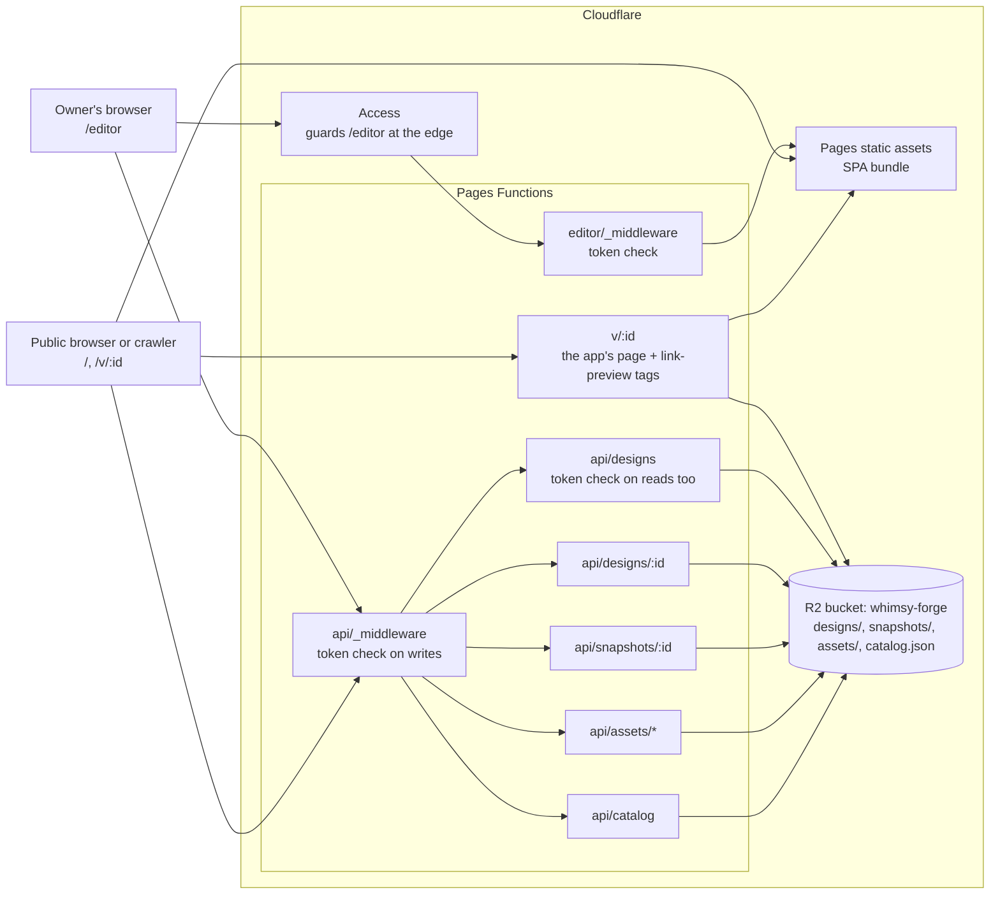
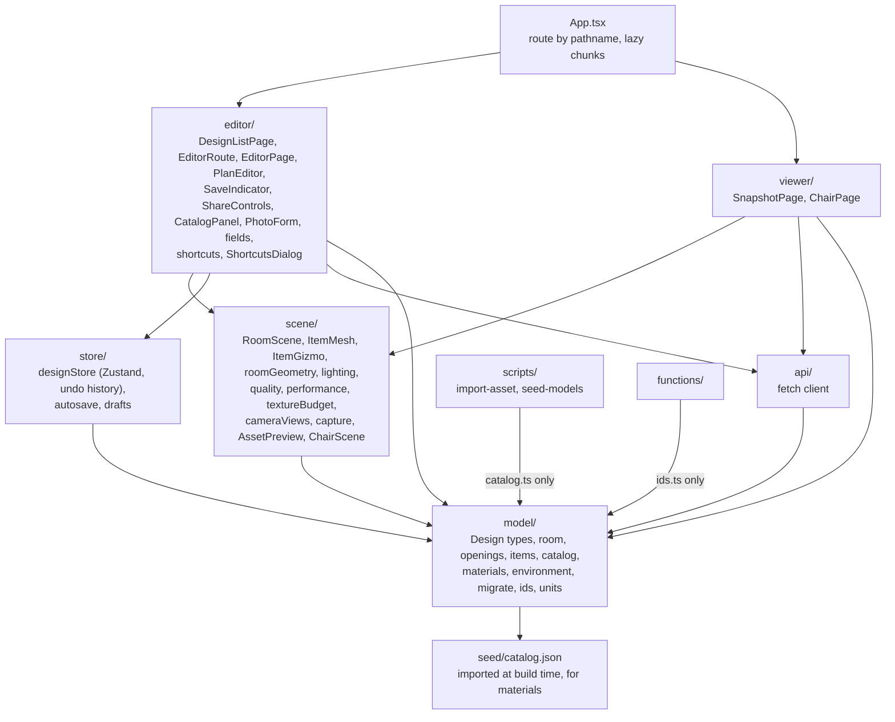
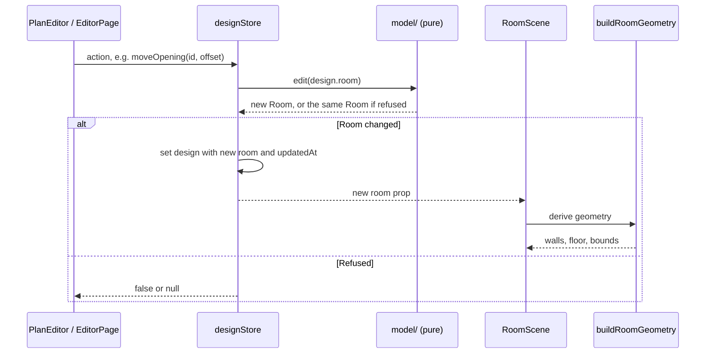
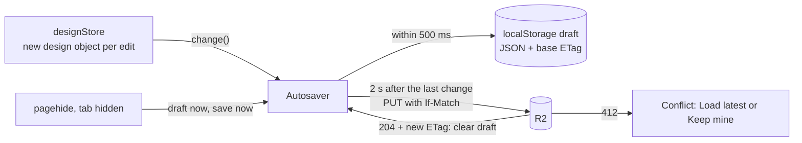
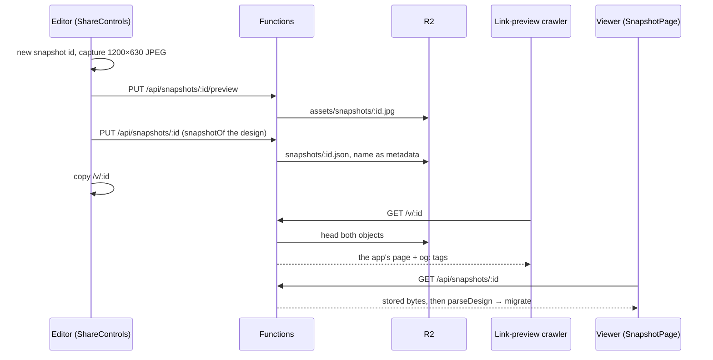
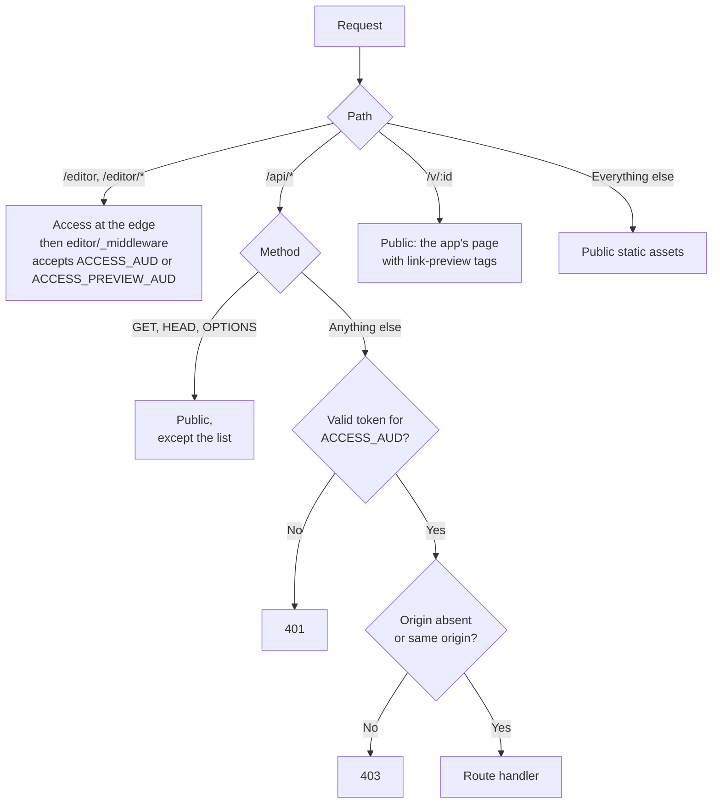
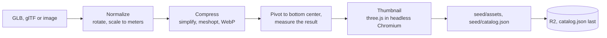

# Whimsy Forge — System Design

**Reflects:** `main` through M7 (Polish).

This document describes the system **as built**. For why the project exists, its requirements and its roadmap, see [PLAN.md](PLAN.md). For one milestone's scope, see [milestones/](milestones/). If this document and the code disagree, the code is right and this document has a bug: fix it.

## Keeping this document live

**Every agent must check this document before every push, and update it in the same push if the branch changes the architecture.** This applies to milestones and to any other work.

Before running `git push`:

1. Run `git fetch origin`, then review what the branch changes with `git diff --stat origin/main...HEAD`.
2. Decide whether any of it is substantive, using the table below.
3. If it is, edit this document and commit the edit so it goes out in that push. Update the **Reflects** line when a milestone's work is included.
4. In the PR description, add a line: `System design: updated (<sections>)` or `System design: no substantive change`.

| Substantive: update this document | Not substantive: leave it alone |
| --- | --- |
| A component, service, binding, environment variable or external dependency is added, removed or replaced | Bug fixes that don't change how the parts relate |
| An API route, its status codes, or who may call it changes | UI details, copy and styling |
| The Design or Asset schema, `schemaVersion`, a migration or the R2 key layout changes | Tunable values such as snapping tolerances |
| A module's responsibility or dependency direction changes, or a new top-level module appears | Refactors inside one module |
| State or data flow changes (store shape, save and load, undo, how the scene is derived) | New tests that follow the existing strategy |
| An invariant or coordinate convention changes | New catalog entries and seed assets |
| Build, test, CI or deployment changes | Ticking milestone checkboxes |
| A decision closes or creates an entry in [Open design questions](#open-design-questions) or [Known limitations](#known-limitations) | |

When unsure, update it; a one-line edit costs little.

How to edit:

- **Rewrite in place.** This is a description of the present, not a changelog; git history is the changelog. Delete what is no longer true.
- **Move built work out of [Planned](#planned-architecture).** Describe it in the as-built sections, and remove its notes and any open question it answers.
- **Copy architecture-level "Decisions made" here.** The PR description is where the owner reviews a decision, and this document is where later agents find it.
- **Keep it at the level of parts and how they relate.** Link to the code for details, and don't restate what a reader gets faster from a file.
- **Resolve conflicts by keeping both sides' facts.** Milestones can run in parallel, so this file may conflict on rebase. After a rebase, repeat the check above.

## System overview

One owner edits designs on a desktop browser. Anyone with a share link can view a frozen copy of a design without an account. The app is a single-page React app on Cloudflare Pages, with a thin Functions API in front of one R2 bucket. All geometry is computed in the browser from a small JSON document.

| Part | Technology | Where |
| --- | --- | --- |
| Front end | TypeScript (strict), Vite, React, Zustand | `src/` |
| 3D | Three.js, React Three Fiber, drei, `three-bvh-csg` | `src/scene/` |
| API | Cloudflare Pages Functions, `jose` for token checks | `functions/` |
| Storage | One R2 bucket, bound as `BUCKET` | `wrangler.toml` |
| Auth | Cloudflare Access, verified again in Functions | `functions/_lib/access.ts` |
| Asset tooling | Node scripts with `gltf-transform`, `sharp` and headless Chromium, run by hand and never in Functions | `scripts/`, `seed/` |
| Lighting | One self-hosted CC0 HDRI, a shadow-casting sun, and lamps from the catalog | `src/scene/lighting.tsx` |
| Photos | Resized and re-encoded to WebP in the browser (Canvas), then uploaded | `src/editor/photo.ts` |

## Core invariants

Changing any of these is a major decision, and must be recorded here.

- **The Design JSON is the source of truth.** The 3D scene and the plan view are derived from it. Editor-only state (active tool, selection, pan and zoom, display unit, view mode) stays in React component state and is not part of the document.
- **Units are meters** in all code and stored data. Only `src/model/units.ts` and the UI deal in feet.
- **Every edit to the room or items is one undo step,** and undo and redo restore them exactly. A pointer gesture (including a gizmo drag) is one step: its edits apply at once and are recorded at the end. A design's name isn't part of the history.
- **Saved work is never silently overwritten.** Autosaves are conditional on the stored version they were edited from, and a mismatch stops saving until the owner chooses. Opening a design never writes it, unless it restores unsaved work.
- **A shared snapshot never changes, and never carries the live design's ID.** The server refuses to replace one, and a snapshot's `id` must equal its own ID, because a live design's ID is enough to read that design and all its future edits.
- **A design from a newer schema is never opened or rewritten** by a build that can't read it. Every load goes through `migrate`, and old documents stay readable through its steps, which are pure and tested against a frozen v1 fixture.
- **`src/model/` holds pure domain logic.** It imports nothing from Three.js, React or Zustand, so it can be tested in Node.
- **Editing functions are pure and refuse invalid edits.** A function such as `setWallLength(room, …)` returns a new `Room`, or the *same object* if the edit is not allowed. The store relies on that identity check to detect a refusal.
- **Design and snapshot IDs are unguessable:** 128 random bits as 22 base64url characters (`src/model/ids.ts`).
- **No secrets in the bundle.** The JavaScript is public, including the editor's chunk; only the `/editor` page route and API writes are guarded.
- **Fail closed.** Missing or malformed Access configuration denies the request.
- **Every third-party asset records its license and source URL** in the catalog. The import refuses an asset without them, and `parseCatalog` leaves such an entry out of the panel.
- **A model file is in meters, with its pivot at bottom center and its front facing +z,** and its catalog `dimensions` are measured from the finished file. `scripts/import/model.ts` guarantees the size and pivot; `--rotate-y` sets the facing by hand.

## Front-end modules

Dependencies point one way, toward `model`.

- **`scene/` does not read the store.** `RoomScene` takes `room` and `items` as props, so the read-only viewer can reuse it without any editing code. The editing props (`editing`, selection, gizmo callbacks) are optional and only the editor passes them. The viewer has its own: `viewRequest`, `onOrbitStart`, `capture`, `onSlowFrames`, `onStats` and `label`.
- **The viewer has no store and no editing code.** `SnapshotPage` holds its design in component state and never writes.
- **`App.tsx` routes on `window.location.pathname`,** with no router library: `/v/<id>` is the read-only viewer, `/editor` is the design list, `/editor/new` creates a design and replaces itself in the address bar with `/editor/<id>`, `/editor/<id>` opens one, and every other path shows the M0 chair page. Moving between the list and the editor is a full page load. Unknown paths reach the app because Pages falls back to `index.html`.
- **Pages are lazy chunks,** which keeps Three.js out of the entry chunk and out of the design list.
- **`store/` doesn't call the API.** `Autosaver` is given its `put` and draft functions, and `editor/EditorRoute.tsx` wires them to `api/` and to the store.

## Data model

Types are in `src/model/design.ts`, `src/model/catalog.ts`, `src/model/materials.ts` and `src/model/environment.ts`. `PLAN.md` has the original sketch; the code is authoritative.

- **Design:** `schemaVersion` (currently 1, from `CURRENT_SCHEMA_VERSION`), `id`, `name`, `updatedAt`, `room`, `items`, `cameras`. `cameras` stays empty on a live design. On a snapshot it holds the view the owner shared from, unless the 3D pane was hidden, and it needed no schema change. The other camera presets are worked out from the room (`src/scene/cameraViews.ts`), not stored.
- **Item:** `id`, `assetId`, `position`, `rotationY`, `size`, `mount` (`floor`, `wall` or `ceiling`), optional `wallId` for a wall item. `position` is the bottom center, whose height a floor or wall item may change (a lamp on a table), and `size` is the footprint in meters, copied at placement so geometry never needs the catalog. `materialOverrides` is defined and not used yet. A photo's `assetId` is `photo:<uploadId>`, and its image is an upload rather than a catalog entry.
- **Room:** `wallHeight`, `walls`, `openings`, optional `floorMaterialId`.
- **Wall:** `start` and `end` in plan coordinates, `thickness`, optional `materialId`.
- **Opening:** belongs to a wall by `wallId`. `offset` runs along the wall from its start to the opening's near edge, and `sill` is the height of its bottom edge above the floor (always 0 for a door).
- **Assets are referenced by ID.** An ID that is unset or no longer in the catalog is not an error: the surface falls back to a plain color.
- **Catalog asset** (`model`, `picture` or `rug`): `id`, `name`, `kind`, `category`, `tags`, `mount`, `url`, `thumbnailUrl`, `dimensions`, `license`, `sourceUrl`. `category` is a closed list in `catalog.ts`, and `mount` is where an item goes when first placed. `dimensions` is always [x, y up, z]: a picture's z is its frame depth and a rug's y its thickness. `license` and `sourceUrl` are separate fields, which departs from PLAN.md's single string. A model that gives light also has `light`: its bulb's `position` from the pivot, `color`, `intensity` and `distance`. An import keeps it only if the request passes it, so `scripts/seed-models.ts` holds the seed lamps' values, and a newly imported lamp gets its `light` added to `seed/catalog.json` by hand.
- **Material asset:** as PLAN.md describes, also with `sourceUrl`, and with an empty `thumbnailUrl` because nothing displays one. Optional `roughness` and `tint` multiply the roughness and color maps, to calibrate a scan: the source parquet is nearly a mirror, and the source "white" plaster is mid-grey.
- **Environment asset** (`kind: 'environment'`): `id`, `name`, `url` of a Radiance `.hdr`, `license`, `sourceUrl`. It isn't placed, so `parseCatalog` leaves it out of the panel.

**Migration.** Every load goes through `parseDesign` → `migrate(doc)` (`src/model/migrate.ts`). It runs the pure steps in `MIGRATIONS`, one per version, then checks the fields the editor reads without a guard. A newer `schemaVersion` throws `NewerSchemaError`, whose message the editor shows instead of opening the design, and anything malformed throws `UnreadableDesignError`. There are no steps yet because the schema is still at 1.

To change the schema, bump `CURRENT_SCHEMA_VERSION` and add one step; `Design['schemaVersion']` follows the constant. Don't edit `src/model/fixtures/design-v1.json`: it stands for documents already in storage, and tests run it through every step. `src/store/schemaBump.test.ts` proves the path with a test-only bump to v2. A migrated document is written back only when next edited, so opening one changes nothing in storage.

**Geometry conventions**

- Plan `[x, y]` maps to world `(x, height, y)`. Seen from above, +y points down the screen, matching the plan view so the two aren't mirrored. This mapping flips handedness: a counterclockwise plan polygon is clockwise in the world (`src/scene/roomGeometry.ts`).
- **The room outline** is found from the walls by `findRoomLoop`: it prunes dead ends, traces the outer boundary, and takes the largest simple polygon. Its edges run counterclockwise. The floor exists only while such an outline does.
- **A wall on the outline** has `start` and `end` on its room-side face, with thickness extending away from the room, so drawn lengths are inside dimensions. **Any other wall** (a partition or an unfinished run) is centered on its line. See `wallFootprints`.
- **Texture coordinates are in meters,** and each material's repeat is set from its tile size, so tiles keep their real-world size on any surface.
- **An item's front faces +z at `rotationY` 0.** Its footprint is its `size` turned by `rotationY` around its `position`. A wall item's back is flush with the wall face nearest where it was placed, and its front points away from the wall (`placeOnWall` in `src/model/items.ts`). Wall items slide along their wall and are re-hung whenever their wall changes; an item whose wall is removed is removed too. A ceiling item's top is at the top of the walls (there is no ceiling surface), and it follows them when the wall height changes.

## Editing and rendering flow

- **One choke point for edits.** Every action in `src/store/designStore.ts` goes through `commit`, which records one undo step, or joins the open gesture. Room edits go through `updateRoom`, which also re-hangs wall items. `setDesign` replaces the whole document and clears the history.
- **Undo is snapshot-based.** Each step holds the room and items as they were before and after the edit. Undo applies the `before` side and redo the `after` side, so both are exact. The history keeps the latest 200 steps and is cleared by `setDesign`.
- **Gestures group a drag into one step.** `beginGesture` and `endGesture` bracket a press in the plan and each gizmo drag. Edits in between apply at once, so the view follows the pointer, and only the end of the gesture is recorded.
- **Items in the scene** are groups named by item id, so the gizmo can find the object it moves. A model is read with `useGLTF`, and a photo's image with `useTexture` from `/api/assets/uploads/`. Until an item's image is known, a box of its size stands in for it. Floor items that overlap in plan and in height get a red footprint, so a lamp on a table isn't flagged; rugs and wall items never count, since rugs sit under things and pictures hang on walls.
- **Openings follow their walls.** Edits to walls and wall height run `refitOpenings`, which refuses the edit if an opening can no longer fit. Removing a wall removes its openings.
- **Geometry is cached per wall.** `buildRoomGeometry` runs on every change, including each pointer move while dragging, so walls are keyed on their inputs and only the wall that changed is cut again with CSG. A material isn't an input, so changing one rebuilds nothing.
- **Rendering is on demand** (`frameloop="demand"`). Anything that changes the picture outside React's props must call `invalidate()`. `?stats` in the viewer is the one exception: it draws every frame, to measure them.
- **The shadow map is redrawn only when something changes.** The sun never moves, so orbiting can't change a shadow, and `gl.shadowMap.autoUpdate` is off. Anything that changes what casts a shadow must call `useShadowRefresh` (`src/scene/lighting.tsx`), as surfaces, items and arriving models do. A shape that doesn't is drawn with a stale shadow.
- **Saving a picture doesn't use `preserveDrawingBuffer`,** which would slow every frame on a phone. `renderToCanvas` (`src/scene/capture.ts`) resizes the renderer, draws once with its own camera, copies to a 2D canvas, then restores the size and redraws, all in one task, so nothing flickers. It works at any size and with the pane hidden. Objects with `CAPTURE_HIDDEN` in `userData` (the gizmo and overlap warnings) are left out, so anything else editor-only that's drawn in the scene needs it too.
- **Textures** load through `/api/assets/*` and are cached for the session per material. The surface shows the material's plain color until they arrive, and stays that way if they fail.
- **Lighting** comes from three sources (`src/scene/lighting.tsx`). An HDRI, self-hosted so scenes make no third-party requests, gives ambient light and reflections but isn't drawn as a backdrop. It's fetched once per session, and local `Lightformer`s stand in until it arrives, or for good if it fails. One directional sun casts soft shadows (`PCFShadowMap`, a soft filter in this version of three.js, with its frustum fitted to the room), and a shadowless fill lifts the walls it can't reach. Lamps are point lights without shadows plus a glow sprite: a point light's shadow would mean six more passes over the scene, so their light passes through walls and furniture, within a short `distance`. Tone mapping is `NeutralToneMapping`, which keeps a material's color.
- **Lamps are worked out from the catalog at render time** (`lampLights` in `src/model/items.ts`), not stored in the design, so nothing in the schema changed. Only the first `maxLamps` lamps in placement order give light, and the editor says so past that.

## Phone budget

The viewer must hold 30 fps on a mid-range phone, which the owner confirmed on a real phone at M7. Three parts serve that.

- **Quality tiers** (`src/scene/quality.ts`): `high`, `medium`, `low` and `minimal` set the pixel ratio, shadow map, lamp count and model texture size. The editor stays at `high`. The viewer starts from what the browser reveals (a touch device starts at `medium`, a small one at `low`), and `FrameBudget` steps down one tier when the median of 30 animation frames is too slow while the scene is drawing. It times the browser's animation frames rather than the scene's draws, because a slow drag on a fast device also draws sparsely. It never steps back up in a session. `?quality=<tier>` pins a tier.
- **Model preparation** (`fitModelToBudget` in `src/scene/textureBudget.ts`), on load, at every tier. Textures are drawn smaller to the tier's limit, because they're uncompressed and a phone's memory runs out before its frame rate does. Transmissive glass becomes plain see-through glass, because three.js draws the whole scene a second time on every frame for any transmissive material. Double-sided transparent materials are drawn in one pass.
- **Enforced numbers:** `e2e/polish.spec.ts` loads a furnished room (`e2e/furnished-room.ts`) at phone size and `medium`, and requires at most 80 draw calls, 300,000 triangles, 150 MB of textures on the GPU and 30 MB of downloads. It stood at 29 draw calls, 184,000 triangles and 109 MB when set. The limits are judgment calls for a mid-range phone, not measurements of one.

**e2e can't measure a phone's frame rate:** it renders in software. `/v/<id>?stats` shows frame rate, draw calls, triangles, texture memory and tier, for checking on a real phone. `E2E_MEASURE=1 npx playwright test capture-furnished --project=phone --workers=1` prints each tier, and `E2E_CAPTURE_DIR` saves pictures of the room.

## Keyboard and accessibility

- **Shortcuts live where their state does:** `EditorPage` handles views, history, selection and the item keys, and `PlanEditor` handles plan tools. Both share `src/editor/shortcuts.ts`, which stops single keys while typing or under an open dialog and holds the list the `?` dialog shows, so a new shortcut must be added to that list by hand. The viewer has its own: number keys choose camera views.
- **Parts of the plan are focusable** SVG buttons: Tab reaches walls, items and openings, and Enter or Space selects one. This is how a keyboard selects anything, since the 3D scene has no keyboard route. Selecting an item is announced through a visually hidden status line.
- **Focus rings** are global (`:focus-visible` in `styles.css`), and `prefers-reduced-motion` turns off CSS motion and camera damping. The viewer's canvas is labeled as an image.

## Saving and loading

- **`Autosaver`** (`src/store/autosave.ts`) keeps one open design saved and reports `saved`, `saving`, `error` or `conflict` to `SaveIndicator`. Saves run one at a time, so each is conditional on the tag the previous one returned. A failure is retried with backoff, from 5 s up to 60 s.
- **What a closed tab loses.** Saves use `fetch` with `keepalive` (under 60 KiB), so a normal close still reaches the server. A killed tab, a crash or a dead network loses at most the last half second, because the draft in this browser restores it on the next open. Drafts don't follow the owner to another browser.
- **Opening a design** (`EditorRoute`, `chooseStartingPoint` in `src/store/drafts.ts`) fetches the stored copy, then uses a local draft only if the draft's `updatedAt` is strictly newer. A restored draft keeps the ETag it was edited from and is saved at once, so if the stored copy moved on meanwhile, that save reports a conflict and overwrites nothing. If a save finished but its tab died before clearing the draft, the two have equal `updatedAt` and the draft is dropped.
- **Conflicts.** A 412 stops saving, and further edits go only to the draft, until the owner picks **Load latest** (drops the draft and reloads) or **Keep mine** (saves with no condition). This covers a second tab, a stale tab left open for days, and a design deleted elsewhere.
- **The undo history isn't persisted.** A reload starts with an empty history.
- **The design list** (`DesignListPage`) reads `GET /api/designs`. Rename and duplicate are done in the browser, as a load through `parseDesign`, a change and a save, so both refuse a design from a newer schema. Deleting one is allowed. A copy shares its uploads with the original, which is safe because uploads are never deleted.

## Sharing

- **A snapshot is a copy of the design in the browser's store,** including edits not saved yet, under its own ID (`snapshotOf` in `src/model/design.ts`). Each Share makes a new snapshot and link, and earlier links keep working. Deleting the design leaves its snapshots.
- **A snapshot is loaded like any design,** through `parseDesign` → `migrate`, so old links keep opening after schema changes. It isn't rewritten: the migration runs on each view.
- **The preview goes first, and is optional.** A link is complete from the moment it exists. If the preview fails, the share goes ahead and the link posts without a picture.
- **Link-preview tags are written by a Function,** `functions/v/[id].ts`, because crawlers don't run JavaScript. It fetches the app's page through the `ASSETS` binding and adds tags. It reads only R2 metadata and never parses the document, to stay well inside the CPU limit. A missing snapshot gets the plain page with status 404, and a storage failure gets the plain page with status 200, so the app can report it. Each page is marked `noindex`.
- **Camera presets:** the viewer opens at the shared view, if any, and offers Overview, Top and, for a closed room, Eye level. Views are worked out for the canvas's shape: on a portrait phone, a shared view from outside the room moves back along its line to fit, and one from inside stays put.
- **Export image** is in both the editor and the viewer. It saves a PNG of the current view, at least 1920 px on its longest side. In the editor with the 3D pane hidden, it saves a framed overview at 16:9.

## API

All routes are in `functions/`. Responses are same-origin, so there is no CORS.

| Route | Who | Behavior |
| --- | --- | --- |
| `GET /api/designs` | Owner, or a preview's token | Every design as `{ id, name, updatedAt }`, newest first, with `Cache-Control: no-store`. 401 without a valid token. |
| `GET /api/designs/:id` | Public | The stored bytes with `Cache-Control: no-store` and an `ETag`. 400 for a malformed ID, 404 if absent. |
| `PUT /api/designs/:id` | Owner, same origin | Stores the received bytes as they are, and returns 204 with the new `ETag`. With `If-Match`, it stores only if that is still the current tag, and otherwise returns 412, including when the design was deleted. Without it, the write is unconditional. 400 for bad UTF-8 or JSON, a body `id` that doesn't match the URL, or a missing numeric `schemaVersion`. 413 over 1 MiB. |
| `DELETE /api/designs/:id` | Owner, same origin | Removes the design and returns 204, even if it was already gone. 400 for a malformed ID. |
| `GET /api/snapshots/:id` | Public | The stored bytes with a one-day browser cache, `ETag` and 304 support. 400 for a malformed ID, 404 if absent. |
| `PUT /api/snapshots/:id` | Owner, same origin | Stores the received bytes as they are, with the name as metadata, and returns 201. 409 if the ID is taken: it never replaces a snapshot. Otherwise validated as `PUT /api/designs/:id` is, so the body's `id` must be the snapshot's. |
| `PUT /api/snapshots/:id/preview` | Owner, same origin | Stores one JPEG at `assets/snapshots/<id>.jpg` and returns 201. 400 for a malformed ID, 415 unless the type is `image/jpeg` and the bytes are a JPEG, 413 over 2 MiB, 409 if the ID is taken. |
| `GET /v/:id` | Public | The app's page, with link-preview tags if the snapshot exists. `no-cache` and status 200, or `no-store` and status 404 if it doesn't. |
| `GET /api/assets/*` | Public | Objects under the `assets/` prefix only, with a one-day browser cache, `ETag` and 304 support. Uploaded photos and snapshot previews are served here too. |
| `PUT /api/uploads/:id` | Owner, same origin | Stores one WebP photo at `assets/uploads/<id>.webp` and returns 201 with its `path`. 400 for a malformed ID, 415 unless the type is `image/webp` and the bytes are a WebP file, 413 over 2 MiB, 409 if the ID is taken. It never replaces an existing upload. |
| `GET /api/catalog` | Public | The bucket's `catalog.json` with `Cache-Control: no-cache`, `ETag` and 304 support, so a new import shows up at once. 404 before the bucket is seeded. |
| Any other `/api/*` | Same check as above by method | JSON 404 from `functions/api/[[path]].ts`, so it doesn't fall through to `index.html`. |

The server validates only the envelope, not the document's contents: the owner is the only writer, and the client's `migrate` handles what it loads. It reads `name` and `updatedAt` from that envelope to store as metadata for the list.

## Security model

There are two tiers: public reads, and owner-only writes and editor.

- **Why `/api` is outside Access:** Access matches paths, not methods, so covering `/api` would put public reads behind a login too. The Function verifies the token on writes instead, using the `CF_Authorization` cookie set when the owner signs in at `/editor`. This depends on Access's **Enforce cookie path attribute** staying off.
- **The Origin check exists because the token can arrive as a cookie,** which a browser would otherwise attach to a write started by another site.
- **Reading a design is a capability, not a right.** `GET /api/designs/:id` is public, so whoever knows a live design's ID can read it and its future edits. A share link and everything the viewer fetches use the snapshot's ID instead, which reads only that frozen copy.
- **Viewer routes need no Access changes.** The production Access application covers only `/editor`, so `/v/*` and the snapshot reads are public there. Restricted previews cover the whole hostname, so on a preview a share link needs a login, and Share itself fails with 401 because previews can't write.
- **The design list is the one read that needs a token,** because it hands out every live design's ID. The handler (`functions/api/designs/index.ts`) checks it itself, since `api/_middleware.ts` passes every GET.
- **Preview deployments can't write.** They share production's bucket. Their Access application's AUD (`ACCESS_PREVIEW_AUD`) opens `/editor` and lists designs for review, but is never accepted for writes. On a preview the editor works and shows **Not saved: signed out**, and edits stay in that origin's local draft. Never add it to `ACCESS_AUD`.
- **`ACCESS_TEST_JWKS`** substitutes a local key set for e2e runs, and is honored only when the request host is `localhost` or `127.0.0.1`.
- **Configuration:** `wrangler.toml` is the source of truth for bindings and variables, none of which are secret. See [setup/cloudflare.md](setup/cloudflare.md) for the dashboard steps.

## Storage

| R2 key | Written by | Read through |
| --- | --- | --- |
| `designs/<id>.json`, with `name` and `updatedAt` as custom metadata | `PUT /api/designs/:id` | `GET /api/designs/:id`, and `GET /api/designs` through R2 `list` |
| `snapshots/<id>.json`, with `name` and `updatedAt` as custom metadata | `PUT /api/snapshots/:id` | `GET /api/snapshots/:id`, and `GET /v/:id` for the metadata |
| `assets/snapshots/<id>.jpg` | `PUT /api/snapshots/:id/preview` | `GET /api/assets/snapshots/<id>.jpg` |
| `assets/<assetId>/<file>`, including the HDRI at `assets/<assetId>/environment.hdr` | `scripts/import-asset.ts`, `scripts/seed-r2.mjs` | `GET /api/assets/*` |
| `assets/uploads/<id>.webp` | `PUT /api/uploads/:id` | `GET /api/assets/uploads/<id>.webp` |
| `catalog.json` | `scripts/import-asset.ts`, `scripts/seed-r2.mjs` | `GET /api/catalog` |

There is no database. D1 is an option in the plan but isn't used: the list is one R2 `list` call with custom metadata, so it reads no documents and has no index to keep in step. The name in the metadata is percent-encoded and cut to 100 code points to stay inside R2's 2 KiB limit. An object saved before M5 has no metadata, so the list shows it as unnamed, with its upload time.

**Snapshots use a flat key,** which departs from PLAN.md's `designs/<id>/snapshots/<timestamp>.json`: that key can't be found from `/v/<snapshotId>` alone, its timestamp is guessable, and putting the design's ID in the link would expose the live design. The flat prefix also keeps snapshots out of the design list's R2 `list`.

**Uploads** are the photos behind pictures and rugs. The browser shrinks each to 1600 px on its longest side and re-encodes it as WebP before upload, so the 2 MiB cap is a ceiling. Only items refer to an upload, and nothing deletes one yet.

**Assets** are checked in under `seed/` and uploaded key for key. A model is `assets/<id>/model.glb`, an image `assets/<id>/image.webp`, and either has `assets/<id>/thumbnail.webp`. Materials are Poly Haven 1K maps converted to WebP by `scripts/fetch-materials.mjs`, and the HDRI is Poly Haven's 1K `.hdr`, fetched as it is by `scripts/fetch-environment.mjs`. Asset paths in the catalog are relative to the API root (`assets/…`), and the client prefixes `/api/`.

**The import pipeline** is `scripts/import-asset.ts` over `scripts/import/`:

- **meshopt and WebP, not Draco and KTX2:** three.js decodes both with no extra fetch, while drei's Draco default loads its decoder from a third-party CDN.
- **`seed/catalog.json` is the catalog's source of truth,** and the bucket's `catalog.json` is a copy of it. An import reads the local file, so it must run from an up-to-date checkout, and `seed/` must be committed afterward.
- **`scripts/seed-models.ts`** rebuilds the seed furniture from Poly Haven through the same pipeline, checking each file's md5 and each model's height against the published size. It doesn't upload.

**The catalog is read two ways.** The catalog panel fetches furniture at runtime through `GET /api/catalog` (`src/api/catalog.ts`), so an import needs no deploy. Materials and the environment stay compiled in: `src/model/materials.ts` and `src/model/environment.ts` import `seed/catalog.json` at build time, because surfaces look materials up synchronously and imports add neither. Seeding doesn't run on deploy: when `seed/` changes other than by an import, run `npm run seed:remote` before merging. Until it runs, production's new material entries point at objects that don't exist and surfaces using them stay a plain color, a new HDRI falls back to built-in light, and the panel and lamps know only what the bucket's `catalog.json` lists.

**Limits** are in [PLAN.md](PLAN.md#cloudflare-free-tier-limits). The 10 ms CPU limit on Functions is the one that shapes the design: heavy work happens in `scripts/` or the browser, never in a Function.

## Build, test and deploy

| Layer | Tool | Runs against |
| --- | --- | --- |
| Domain logic, geometry, store, autosave | Vitest in Node (`src/**/*.test.ts`) | Pure functions, and `Autosaver` with fake timers and a hand-answered server |
| Import pipeline, seed catalog | Vitest in Node (`tests/scripts/`) | The pipeline with a stub thumbnail renderer, and the checked-in GLBs: sizes, pivots, seat heights, budgets |
| Functions | Vitest (`tests/functions/`) | Handlers called directly |
| End to end | Playwright (`e2e/`) | A fresh build on the real Pages runtime (workerd) with local R2. Every seed model is loaded in the browser and measured, and one test runs the real import command |

- **Access in e2e:** `playwright.config.ts` generates a throwaway RSA key each run, and `e2e/access-token.ts` signs short-lived tokens with it, so the real verification path is exercised.
- **Browsers:** a desktop project runs every spec and a phone project runs the chair, share and polish specs. `capture-furnished.spec.ts` skips itself unless asked to measure or take pictures. Both use software WebGL, so no GPU is needed: SwiftShader by default, or the ANGLE backend named by `E2E_ANGLE`.
- **CI** (`.github/workflows/ci.yml`) runs build, unit tests and e2e on pushes to `main` and on pull requests. Its e2e step installs Mesa and sets `E2E_ANGLE=gl-egl` to render with llvmpipe, because SwiftShader with two workers overloads the runner until tests time out.
- **Deploys** use Pages' Git integration: `main` goes to production (`whimsy-forge-cze.pages.dev`), and other branches go to Access-restricted previews (`<branch>.whimsy-forge-cze.pages.dev`).
- **Scripts** are TypeScript run directly by Node 22.18+ with type stripping, and type-checked by `tsconfig.node.json`. `scripts/seed-r2.mjs` uses `wrangler r2 bulk put`, grouped by content type, to keep the e2e server's start within its timeout.
- **Local development:** see [README.md](../README.md#development). `npm run dev:pages` is the whole stack; `npm run dev` adds hot reload and proxies `/api` to it.

## Known limitations

| Limitation | Why it's acceptable for now | Addressed by |
| --- | --- | --- |
| Designs written by the old save check remain in the production bucket, shown as unnamed | Small; delete them from the list | Owner, once |
| A draft of a design deleted from another browser stays in this browser's storage, and can recreate the design if this browser opens its address | One owner, usually one browser | Not planned |
| `/` shows the M0 chair page | Nothing else needs that address yet | Not planned yet |
| A share link can't be revoked from the app, and snapshots are never deleted, even with their design | Links are unguessable, and each snapshot is small. To revoke one, delete its two objects in the R2 dashboard; a browser that has it may keep it for up to a day | Not planned yet |
| A snapshot freezes the document, not the assets it refers to. Replacing an asset at the same key or removing it from the catalog changes what old links show | Assets rarely change, and a missing one shows as a box of the right size | Use a new asset ID instead of `--replace` |
| A failed Share can leave an unused preview image in storage | Small and unreachable without its random ID | Not planned |
| Replacing an asset at the same key can be stale in browsers for up to a day | Assets rarely change | Use a new asset ID instead of `--replace` |
| An import from a stale checkout overwrites the bucket's `catalog.json` with that checkout's list | One owner, one machine; `seed/` is committed after each import | Not planned |
| `seed/` holds finished binaries in git | Small so far, and it lets e2e and `seed:remote` run with no other source | Move out of git if it grows large |
| At 1280 px wide with the catalog open, the plan's status line truncates (full text in its tooltip) | The header's Catalog button gives the width back | Revisit with the editor's panels |
| A photo is placed once from its upload; there is no library, so placing it again needs a new upload | Keeps M4 to the placement workflow | Not planned yet |
| Uploads are never deleted, even when no item uses them any more | Storage is small, and deletion needs a reference check | Not planned yet |
| The undo history is lost on reload | The design itself is safe; history is only for the session | Not planned |
| Lamps cast no shadows, and their light passes through walls | A shadow per lamp is too costly on a phone, and a room's lamps are mostly in that room | Not planned |
| Lamps have no on/off or dimmer, and only the first few give light | Keeps the Design schema unchanged | Not planned yet |
| A ceiling item placed before M7 stays on the floor until the room is next edited | M4's placement put it there; `followWalls` corrects it on the next room edit, but a snapshot stays as it was | Not planned |
| A phone's saved image uses its smaller model textures | Export from a desktop for the best picture | Not planned |

## Planned architecture

**Not built.** These notes record what the current architecture implies for coming milestones. They aren't decisions: the milestone's agent decides, then moves the result into the as-built sections above.

None at the moment: every milestone in [PLAN.md](PLAN.md) has been built.

## Open design questions

Gaps between [PLAN.md](PLAN.md) and the architecture as built. Remove each one when it is decided, and record the outcome above.

None at the moment.
