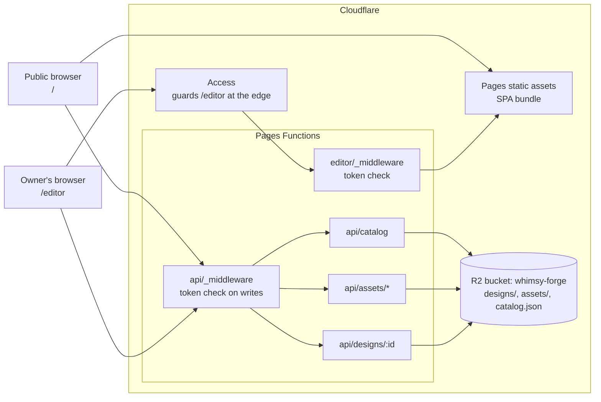
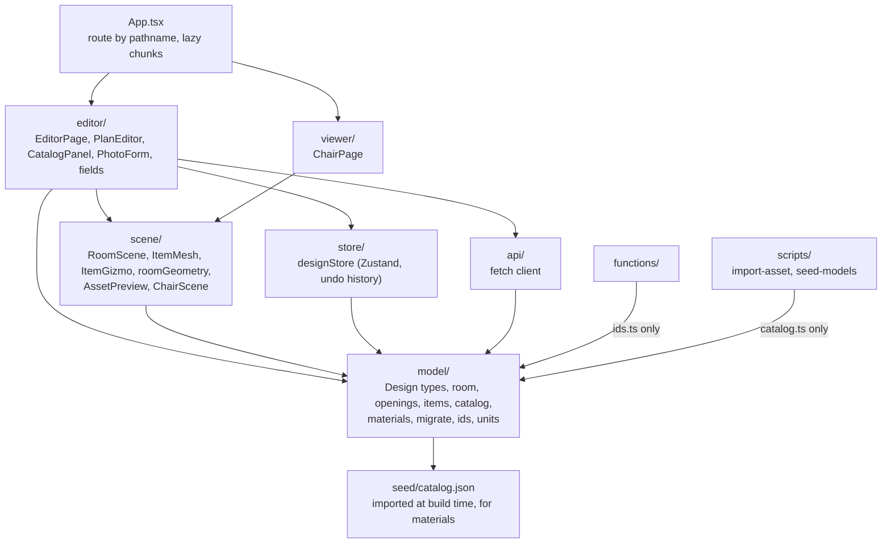
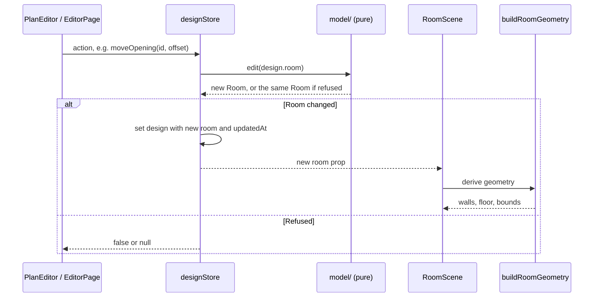
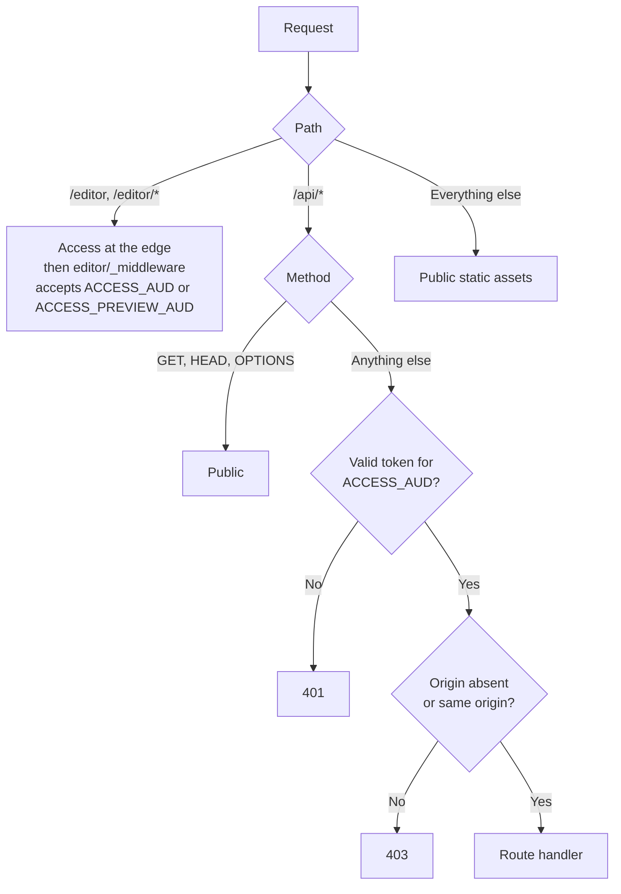
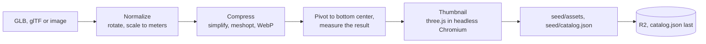

# Whimsy Forge — System Design

**Reflects:** `main` through M4 (Placement and editing).

This document describes the system **as built**. For why the project exists, its requirements and its roadmap, see [PLAN.md](PLAN.md). For one milestone's scope, see [milestones/](milestones/). If this document and the code disagree, the code is right and this document has a bug: fix it.

## Keeping this document live

**Every agent must check this document before every push, and update it in the same push if the branch changes the architecture.** This applies to milestones and to any other work.

Before running `git push`:

1. Run `git fetch origin`, then review what the branch changes with `git diff --stat origin/main...HEAD`.
2. Decide whether any of it is substantive, using the table below.
3. If it is, edit this document and commit the edit so it goes out in that push. Update the **Reflects** line when a milestone's work is included.
4. In the PR description, add a line: `System design: updated (<sections>)` or `System design: no substantive change`.

| Substantive: update this document | Not substantive: leave it alone |
| --- | --- |
| A component, service, binding, environment variable or external dependency is added, removed or replaced | Bug fixes that don't change how the parts relate |
| An API route, its status codes, or who may call it changes | UI details, copy and styling |
| The Design or Asset schema, `schemaVersion`, a migration or the R2 key layout changes | Tunable values such as snapping tolerances |
| A module's responsibility or dependency direction changes, or a new top-level module appears | Refactors inside one module |
| State or data flow changes (store shape, save and load, undo, how the scene is derived) | New tests that follow the existing strategy |
| An invariant or coordinate convention changes | New catalog entries and seed assets |
| Build, test, CI or deployment changes | Ticking milestone checkboxes |
| A decision closes or creates an entry in [Open design questions](#open-design-questions) or [Known limitations](#known-limitations) | |

When unsure, update it; a one-line edit costs little.

How to edit:

- **Rewrite in place.** This is a description of the present, not a changelog; git history is the changelog. Delete what is no longer true.
- **Move built work out of [Planned](#planned-architecture).** Describe it in the as-built sections, and remove its notes and any open question it answers.
- **Copy architecture-level "Decisions made" here.** The PR description is where the owner reviews a decision, and this document is where later agents find it.
- **Keep it at the level of parts and how they relate.** Link to the code for details, and don't restate what a reader gets faster from a file.
- **Resolve conflicts by keeping both sides' facts.** Milestones can run in parallel, so this file may conflict on rebase. After a rebase, repeat the check above.

## System overview

One owner edits designs on a desktop browser. Anyone with a share link will be able to view a design without an account (M6). The app is a single-page React app on Cloudflare Pages, with a thin Functions API in front of one R2 bucket. All geometry is computed in the browser from a small JSON document.

| Part | Technology | Where |
| --- | --- | --- |
| Front end | TypeScript (strict), Vite, React, Zustand | `src/` |
| 3D | Three.js, React Three Fiber, drei, `three-bvh-csg` | `src/scene/` |
| API | Cloudflare Pages Functions, `jose` for token checks | `functions/` |
| Storage | One R2 bucket, bound as `BUCKET` | `wrangler.toml` |
| Auth | Cloudflare Access, verified again in Functions | `functions/_lib/access.ts` |
| Asset tooling | Node scripts with `gltf-transform`, `sharp` and headless Chromium, run by hand and never in Functions | `scripts/`, `seed/` |
| Photos | Resized and re-encoded to WebP in the browser (Canvas), then uploaded | `src/editor/photo.ts` |

## Core invariants

Changing any of these is a major decision, and must be recorded here.

- **The Design JSON is the source of truth.** The 3D scene and the plan view are derived from it. Editor-only state (active tool, selection, pan and zoom, display unit, view mode) stays in React component state and is not part of the document.
- **Units are meters** in all code and stored data. Only `src/model/units.ts` and the UI deal in feet.
- **Every edit to the design is one undo step,** and undo and redo restore the design exactly. A pointer gesture (including a gizmo drag) is one step: its edits apply at once and are recorded at the end.
- **`src/model/` holds pure domain logic.** It imports nothing from Three.js, React or Zustand, so it can be tested in Node.
- **Editing functions are pure and refuse invalid edits.** A function such as `setWallLength(room, …)` returns a new `Room`, or the *same object* if the edit is not allowed. The store relies on that identity check to detect a refusal.
- **Design and snapshot IDs are unguessable:** 128 random bits as 22 base64url characters (`src/model/ids.ts`).
- **No secrets in the bundle.** The JavaScript is public, including the editor's chunk; only the `/editor` page route and API writes are guarded.
- **Fail closed.** Missing or malformed Access configuration denies the request.
- **Every third-party asset records its license and source URL** in the catalog. The import refuses an asset without them, and `parseCatalog` leaves such an entry out of the panel.
- **A model file is in meters, with its pivot at bottom center and its front facing +z,** and its catalog `dimensions` are measured from the finished file. `scripts/import/model.ts` guarantees the size and pivot; `--rotate-y` sets the facing by hand.

## Front-end modules

Dependencies point one way, toward `model`.

- **`scene/` does not read the store.** `RoomScene` takes `room` and `items` as props, so the read-only viewer can reuse it without any editing code. The editing props (`editing`, selection, gizmo callbacks) are optional and only the editor passes them.
- **`App.tsx` routes on `window.location.pathname`,** with no router library: `/editor` and `/editor/*` open the editor, and every other path shows the M0 chair page. Unknown paths reach the app because Pages falls back to `index.html`.
- **Pages are lazy chunks,** which keeps Three.js out of the entry chunk.

## Data model

Types are in `src/model/design.ts`, `src/model/catalog.ts` and `src/model/materials.ts`. `PLAN.md` has the original sketch; the code is authoritative.

- **Design:** `schemaVersion` (currently 1), `id`, `name`, `updatedAt`, `room`, `items`, `cameras`. `cameras` is defined and always empty until M6.
- **Item:** `id`, `assetId`, `position`, `rotationY`, `size`, `mount` (`floor`, `wall` or `ceiling`), optional `wallId` for a wall item. `position` is the bottom center, and `size` is the footprint in meters, copied at placement so geometry never needs the catalog. `materialOverrides` is defined and not used yet. A photo's `assetId` is `photo:<uploadId>`, and its image is an upload rather than a catalog entry.
- **Room:** `wallHeight`, `walls`, `openings`, optional `floorMaterialId`.
- **Wall:** `start` and `end` in plan coordinates, `thickness`, optional `materialId`.
- **Opening:** belongs to a wall by `wallId`. `offset` runs along the wall from its start to the opening's near edge, and `sill` is the height of its bottom edge above the floor (always 0 for a door).
- **Assets are referenced by ID.** An ID that is unset or no longer in the catalog is not an error: the surface falls back to a plain color.
- **Catalog asset** (`model`, `picture` or `rug`): `id`, `name`, `kind`, `category`, `tags`, `mount`, `url`, `thumbnailUrl`, `dimensions`, `license`, `sourceUrl`. `category` is a closed list in `catalog.ts`, and `mount` is where an item goes when first placed. `dimensions` is always [x, y up, z]: a picture's z is its frame depth and a rug's y its thickness. `license` and `sourceUrl` are separate fields, which departs from PLAN.md's single string.
- **Material asset:** as PLAN.md describes, also with `sourceUrl`, and with an empty `thumbnailUrl` because nothing displays one.

**Migration.** Every load goes through `parseDesign` → `migrate(doc)`. Today `migrate` accepts only the current version and throws on anything else. M5 adds real steps.

**Geometry conventions**

- Plan `[x, y]` maps to world `(x, height, y)`. Seen from above, +y points down the screen, matching the plan view so the two aren't mirrored. This mapping flips handedness: a counterclockwise plan polygon is clockwise in the world (`src/scene/roomGeometry.ts`).
- **The room outline** is found from the walls by `findRoomLoop`: it prunes dead ends, traces the outer boundary, and takes the largest simple polygon. Its edges run counterclockwise. The floor exists only while such an outline does.
- **A wall on the outline** has `start` and `end` on its room-side face, with thickness extending away from the room, so drawn lengths are inside dimensions. **Any other wall** (a partition or an unfinished run) is centered on its line. See `wallFootprints`.
- **Texture coordinates are in meters,** and each material's repeat is set from its tile size, so tiles keep their real-world size on any surface.
- **An item's front faces +z at `rotationY` 0.** Its footprint is its `size` turned by `rotationY` around its `position`. A wall item's back is flush with the wall face nearest where it was placed, and its front points away from the wall (`placeOnWall` in `src/model/items.ts`). Wall items slide along their wall and are re-hung whenever their wall changes; an item whose wall is removed is removed too.

## Editing and rendering flow

- **One choke point for edits.** Every action in `src/store/designStore.ts` goes through `commit`, which records one undo step, or joins the open gesture. Room edits go through `updateRoom`, which also re-hangs wall items. `setDesign` replaces the whole document and clears the history.
- **Undo is snapshot-based.** Each step holds the room and items as they were before and after the edit. Undo applies the `before` side and redo the `after` side, so both are exact. The history keeps the latest 200 steps and is cleared by `setDesign`.
- **Gestures group a drag into one step.** `beginGesture` and `endGesture` bracket a press in the plan and each gizmo drag. Edits in between apply at once, so the view follows the pointer, and only the end of the gesture is recorded.
- **Items in the scene** are groups named by item id, so the gizmo can find the object it moves. A model is read with `useGLTF`, and a photo's image with `useTexture` from `/api/assets/uploads/`. Until an item's image is known, a box of its size stands in for it. Overlapping floor items get a red footprint; rugs and wall items never count, since rugs sit under things and pictures hang on walls.
- **Openings follow their walls.** Edits to walls and wall height run `refitOpenings`, which refuses the edit if an opening can no longer fit. Removing a wall removes its openings.
- **Geometry is cached per wall.** `buildRoomGeometry` runs on every change, including each pointer move while dragging, so walls are keyed on their inputs and only the wall that changed is cut again with CSG. A material isn't an input, so changing one rebuilds nothing.
- **Rendering is on demand** (`frameloop="demand"`). Anything that changes the picture outside React's props must call `invalidate()`.
- **Textures** load through `/api/assets/*` and are cached for the session per material. The surface shows the material's plain color until they arrive, and stays that way if they fail.
- **Lighting** uses local drei `Lightformer`s rather than a fetched HDRI, so scenes make no third-party requests.

## API

All routes are in `functions/`. Responses are same-origin, so there is no CORS.

| Route | Who | Behavior |
| --- | --- | --- |
| `GET /api/designs/:id` | Public | The stored bytes with `Cache-Control: no-store` and an `ETag`. 400 for a malformed ID, 404 if absent. |
| `PUT /api/designs/:id` | Owner, same origin | Stores the received bytes as they are, and returns 204. 400 for bad UTF-8 or JSON, a body `id` that doesn't match the URL, or a missing numeric `schemaVersion`. 413 over 1 MiB. |
| `GET /api/assets/*` | Public | Objects under the `assets/` prefix only, with a one-day browser cache, `ETag` and 304 support. Uploaded photos are served here too. |
| `PUT /api/uploads/:id` | Owner, same origin | Stores one WebP photo at `assets/uploads/<id>.webp` and returns 201 with its `path`. 400 for a malformed ID, 415 unless the type is `image/webp` and the bytes are a WebP file, 413 over 2 MiB, 409 if the ID is taken. It never replaces an existing upload. |
| `GET /api/catalog` | Public | The bucket's `catalog.json` with `Cache-Control: no-cache`, `ETag` and 304 support, so a new import shows up at once. 404 before the bucket is seeded. |
| Any other `/api/*` | Same check as above by method | JSON 404 from `functions/api/[[path]].ts`, so it doesn't fall through to `index.html`. |

The server validates only the envelope, not the document's contents: the owner is the only writer, and the client's `migrate` handles what it loads. Saves are last-write-wins.

## Security model

There are two tiers: public reads, and owner-only writes and editor.

- **Why `/api` is outside Access:** Access matches paths, not methods, so covering `/api` would put public reads behind a login too. The Function verifies the token on writes instead, using the `CF_Authorization` cookie set when the owner signs in at `/editor`. This depends on Access's **Enforce cookie path attribute** staying off.
- **The Origin check exists because the token can arrive as a cookie,** which a browser would otherwise attach to a write started by another site.
- **Reading a design is a capability, not a right.** `GET /api/designs/:id` is public, so whoever knows a live design's ID can read it and its future edits. Never expose that ID in a share link.
- **Preview deployments can't write.** They share production's bucket. Their Access application's AUD (`ACCESS_PREVIEW_AUD`) opens `/editor` for review but is never accepted for writes. A 401 from **Run save and load check** on a preview is expected. Never add it to `ACCESS_AUD`.
- **`ACCESS_TEST_JWKS`** substitutes a local key set for e2e runs, and is honored only when the request host is `localhost` or `127.0.0.1`.
- **Configuration:** `wrangler.toml` is the source of truth for bindings and variables, none of which are secret. See [setup/cloudflare.md](setup/cloudflare.md) for the dashboard steps.

## Storage

| R2 key | Written by | Read through |
| --- | --- | --- |
| `designs/<id>.json` | `PUT /api/designs/:id` | `GET /api/designs/:id` |
| `assets/<assetId>/<file>` | `scripts/import-asset.ts`, `scripts/seed-r2.mjs` | `GET /api/assets/*` |
| `assets/uploads/<id>.webp` | `PUT /api/uploads/:id` | `GET /api/assets/uploads/<id>.webp` |
| `catalog.json` | `scripts/import-asset.ts`, `scripts/seed-r2.mjs` | `GET /api/catalog` |

There is no database. D1 is an option in the plan but isn't used.

**Uploads** are the photos behind pictures and rugs. The browser shrinks each to 1600 px on its longest side and re-encodes it as WebP before upload, so the 2 MiB cap is a ceiling. Only items refer to an upload, and nothing deletes one yet.

**Assets** are checked in under `seed/` and uploaded key for key. A model is `assets/<id>/model.glb`, an image `assets/<id>/image.webp`, and either has `assets/<id>/thumbnail.webp`. Materials are Poly Haven 1K maps converted to WebP by `scripts/fetch-materials.mjs`. Asset paths in the catalog are relative to the API root (`assets/…`), and the client prefixes `/api/`.

**The import pipeline** is `scripts/import-asset.ts` over `scripts/import/`:

- **meshopt and WebP, not Draco and KTX2:** three.js decodes both with no extra fetch, while drei's Draco default loads its decoder from a third-party CDN.
- **`seed/catalog.json` is the catalog's source of truth,** and the bucket's `catalog.json` is a copy of it. An import reads the local file, so it must run from an up-to-date checkout, and `seed/` must be committed afterward.
- **`scripts/seed-models.ts`** rebuilds the seed furniture from Poly Haven through the same pipeline, checking each file's md5 and each model's height against the published size. It doesn't upload.

**The catalog is read two ways.** The catalog panel fetches furniture at runtime through `GET /api/catalog` (`src/api/catalog.ts`), so an import needs no deploy. Materials stay compiled in: `src/model/materials.ts` imports `seed/catalog.json` at build time, because surfaces look them up synchronously and imports don't add them. Seeding doesn't run on deploy: when `seed/` changes other than by an import, run `npm run seed:remote` before merging. Until it runs, production's new material entries point at objects that don't exist and surfaces using them stay a plain color, and the panel lists only what the bucket's `catalog.json` lists.

**Limits** are in [PLAN.md](PLAN.md#cloudflare-free-tier-limits). The 10 ms CPU limit on Functions is the one that shapes the design: heavy work happens in `scripts/` or the browser, never in a Function.

## Build, test and deploy

| Layer | Tool | Runs against |
| --- | --- | --- |
| Domain logic, geometry, store | Vitest in Node (`src/**/*.test.ts`) | Pure functions |
| Import pipeline, seed catalog | Vitest in Node (`tests/scripts/`) | The pipeline with a stub thumbnail renderer, and the checked-in GLBs: sizes, pivots, seat heights, budgets |
| Functions | Vitest (`tests/functions/`) | Handlers called directly |
| End to end | Playwright (`e2e/`) | A fresh build on the real Pages runtime (workerd) with local R2. Every seed model is loaded in the browser and measured, and one test runs the real import command |

- **Access in e2e:** `playwright.config.ts` generates a throwaway RSA key each run, and `e2e/access-token.ts` signs short-lived tokens with it, so the real verification path is exercised.
- **Browsers:** a desktop project runs every spec and a phone project runs the chair spec. Both use software WebGL, so no GPU is needed: SwiftShader by default, or the ANGLE backend named by `E2E_ANGLE`.
- **CI** (`.github/workflows/ci.yml`) runs build, unit tests and e2e on pushes to `main` and on pull requests. Its e2e step installs Mesa and sets `E2E_ANGLE=gl-egl` to render with llvmpipe, because SwiftShader with two workers overloads the runner until tests time out.
- **Deploys** use Pages' Git integration: `main` goes to production (`whimsy-forge-cze.pages.dev`), and other branches go to Access-restricted previews (`<branch>.whimsy-forge-cze.pages.dev`).
- **Scripts** are TypeScript run directly by Node 22.18+ with type stripping, and type-checked by `tsconfig.node.json`. `scripts/seed-r2.mjs` uses `wrangler r2 bulk put`, grouped by content type, to keep the e2e server's start within its timeout.
- **Local development:** see [README.md](../README.md#development). `npm run dev:pages` is the whole stack; `npm run dev` adds hot reload and proxies `/api` to it.

## Known limitations

| Limitation | Why it's acceptable for now | Addressed by |
| --- | --- | --- |
| The editor keeps its design in memory, so a reload loses it | Persistence is a later milestone | M5 |
| `SaveCheck` writes a new design to R2 on each run and never deletes it | Small test documents; temporary tool | M5 should remove it |
| Saves are last-write-wins, so two open tabs can overwrite each other | One editor | Consider in M5; `ETag` is already returned |
| `/` shows the M0 chair page, and `/v/*` does too | No viewer yet | M6 |
| Replacing an asset at the same key can be stale in browsers for up to a day | Assets rarely change | Use a new asset ID instead of `--replace` |
| An import from a stale checkout overwrites the bucket's `catalog.json` with that checkout's list | One owner, one machine; `seed/` is committed after each import | Not planned |
| `seed/` holds finished binaries in git | Small so far, and it lets e2e and `seed:remote` run with no other source | Move out of git if it grows large |
| At 1280 px wide with the catalog open, the plan's status line truncates (full text in its tooltip) | The header's Catalog button gives the width back | Revisit with the editor's panels |
| A photo is placed once from its upload; there is no library, so placing it again needs a new upload | Keeps M4 to the placement workflow | Not planned yet |
| Uploads are never deleted, even when no item uses them any more | Storage is small, and deletion needs a reference check | Not planned yet |
| Item edits are not saved; the room, items and undo history live in memory | Persistence is a later milestone | M5 |

## Planned architecture

**Not built.** These notes record what the current architecture implies for coming milestones. They aren't decisions: the milestone's agent decides, then moves the result into the as-built sections above.

| Milestone | Adds | Notes for the implementer |
| --- | --- | --- |
| M5 Persistence | Autosave, design list, real migrations | See question 2. `Design['schemaVersion']` is a literal type and `migrate` rejects everything else, so both change at the first bump. |
| M6 Sharing | Snapshots, `/v/<id>` viewer, image export, Open Graph tags | See questions 3 and 4. `RoomScene` can be reused because it takes props. Image export needs a look at `frameloop="demand"` and `preserveDrawingBuffer`. |
| M7 Polish | HDRI, soft shadows, lamps, phone budget | An HDRI should be self-hosted in R2 to keep scenes free of third-party requests. Budget: textures up to 2048 px, roughly 30 MB per design. |

## Open design questions

Gaps between [PLAN.md](PLAN.md) and the architecture as built. Remove each one when it is decided, and record the outcome above.

2. **How is the design list protected? (M5)** `api/_middleware.ts` makes every `GET` public. A `GET /api/designs` list would hand out every live design's ID, which is a read capability, so it needs its own owner check, which the middleware doesn't currently offer per route. Listing could use R2 `list`, or the plan's optional D1 index.
3. **What is a snapshot's storage key? (M6)** The plan's `designs/<id>/snapshots/<timestamp>.json` can't be resolved from `/v/<snapshotId>` alone, and timestamps are guessable. Embedding the design ID in the link would expose the live design. A flat key such as `snapshots/<snapshotId>.json` avoids both, but it departs from the plan's layout.
4. **How do Open Graph tags get served? (M6)** The app is static, and link-preview crawlers don't run JavaScript. `/v/:id` would need a Function that writes per-snapshot tags into `index.html`, and a preview image captured at share time, since the server can't render one.
