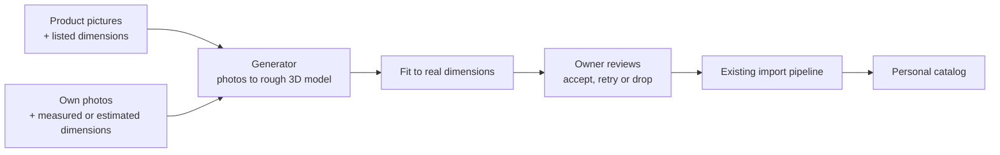

# Asset capture

**Status:** draft; the owner has made the decisions below, and spike 0 is next. **Parent issues:** #16 shopping capture (first), #15 real-life capture (second).

## Problem and outcome

The catalog only holds models someone else has already built, so a design can't show the sofa the owner is about to buy, or the chair they already own. The owner wants to turn these into catalog assets at real-world size:

- **Shopping capture,** built first: an online shop's product pictures, listed dimensions and product page.
- **Real-life capture,** built second: photos of a physical piece of furniture. Its dimensions come from measurements, or are estimated from a tape measure or marker in the photos.

Both have the same shape, so they share one path and differ only at the start:

## Out of scope

Buying through the app, a catalog for other people, and matching a product automatically from a design. Linking an asset to the product page it came from is in scope.

## What the current system means for this

- **Most of the back half exists.** `scripts/import-asset.ts` already takes a GLB, simplifies and compresses it, sets the pivot, renders a thumbnail and uploads it.
- **Fitting is uniform and single-axis.** The import accepts only one of `--width`, `--height` and `--depth`. A listing's W × H × D needs a new option, and a choice about how far a generated model may be stretched.
- **`sourceUrl` must be an http(s) URL.** `parseCatalog` hides any entry without one. A shop asset has its product URL, so this doesn't affect shopping capture, but a scan of the owner's own chair can't appear today. For real-life capture, the [provenance rule](../SYSTEM_DESIGN.md#core-invariants) has to change without weakening it for third-party assets.
- **Everything imported is public.** `seed/` is committed to a public repository, and `GET /api/catalog` and `GET /api/assets/*` are public. A model made from a shop's images or from photos of the owner's home would be world-readable, and the source photos must never go there.
- **Heavy work can't run in Functions.** Generation runs in `scripts/` or on an outside service. A web upload would also need a new owner-only route.
- **Front direction is set by hand** with `--rotate-y`. A generated model may face any way, so review needs to set it.
- **Generated models must fit the [phone budget](../SYSTEM_DESIGN.md#phone-budget).** The import's 60,000-triangle and 1024 px defaults help, but simplifying may damage a generated mesh, so the evaluation measures it.
- **`seed/` holds binaries in git,** a [known limitation](../SYSTEM_DESIGN.md#known-limitations) that many personal assets would make worse. `tests/scripts/seed-catalog.test.ts` also needs a hand-written size range for every model in `seed/`, so a personal asset committed there would fail CI until one is added.

## Decisions

Made by the owner on 2026-11-05 and 2026-11-08.

- **Shopping capture comes first.** The listing gives the dimensions, so the hardest part of real-life capture, measuring, isn't needed yet. Product photos are clean, multi-angle and on plain backgrounds, which suits generators best. And it's where a model helps a decision: whether to buy. Real-life capture then adds only what's specific to it.
- **Personal assets live in an R2-only personal catalog,** out of git, under unguessable IDs. This changes the storage model, and slice 2 designs the details.
- **Models made from a shop's images are for private use at first.** They stay out of share links. Copyright in product photos, and in a model derived from them, belongs to someone else, and this needs a real look before changing the decision. Slice 2 designs what a viewer sees instead, such as a generic placeholder of the right size.
- **An asset sourced from a shop links to its product page.** The URL is recorded as its `sourceUrl`, and the editor shows it as a link.
- **Dimensions for real-life capture are estimated from the photos, and the owner confirms them.** One trusted length is enough to scale a model whose proportions are right, and the other two then check the generator. Spike 0 measures how close the estimates get.

## Open questions

| Question | Who decides | Options and recommendation |
| --- | --- | --- |
| Which generator? | Owner, because a paid service may be involved | Hosted image-to-3D API, an open model on a local or rented GPU, or a phone scanning app that exports a model (real-life capture only). **Decide after spike 0.** |
| What does a share link's viewer load for a private asset? | Agent, in slice 2 | **Decided in slice 2 (#21):** a box of the item's size, and a note that some items are private. See Findings below. |
| Fetch product pages automatically? | Agent, in slice 5, unless it needs a paid service | Shops block bots and their terms vary, so slice 3 starts from saved images and typed dimensions. For slice 5, **recommend reading the page the owner already has open in their own browser,** through Claude in Chrome or a small bookmarklet, rather than fetching it from a script or a Function, which several large shops will refuse. Read structured data before scraping: the schema.org `Product` data in the page gives the full-size images, name and canonical URL; shop-platform endpoints such as Shopify's `/products/<handle>.json` give every image; `og:image` is a last resort. Dimensions are usually free text in a spec table, which Claude can read, as long as each axis is labeled rather than taken by position (shops write W × D × H as often as W × H × D), the overall size is used rather than seat or arm height, and the original text is kept for the owner to confirm at review. The fetch also sorts the images, since clean product shots from several angles suit the generator and styled room photos don't. |
| What does the `capture` command take as input? | Agent, in slice 3 | **Recommend a capture bundle:** a folder of images outside the repository, plus a `capture.json` with the name, the product URL as `sourceUrl`, labeled W, H and D in meters with the original text, each image's role, and any shop 3D model URL. Saving by hand and slice 5's fetch both produce one, so slice 5 is a thin adapter, and tests use fixture bundles and never fetch a shop page. |
| Use a shop's own 3D model when it has one? | Agent, in slice 5; spike 0 records how often it applies | Some large shops offer "view in your room" AR, and the page links the model: `<model-viewer src="….glb">`, `<a rel="ar" href="….usdz">`, or a `3DModel` in the structured data. Such a model is already at real scale, so it can skip the generator and go straight to the import, and it should beat any generated model on the 2 cm bar. A `.usdz` file needs converting to GLB first. It is still the shop's copyright, so the private-use decision applies unchanged. **Recommend trying it first when present,** and recording in spike 0 how many of the shop set offer one, since that decides how much the generator matters for shop input. |
| How does a model record its provenance? | Agent, in slice 4 | For example a `provenance` field of `third-party` or `own-capture`, requiring `license` and `sourceUrl` only for third-party assets. |
| How are dimensions estimated from photos? | Agent, after spike 0 | A tape measure against the piece's bottom edge, one more photo with the tape held upright for height, or a printed marker of known size, which software finds most reliably. Depth-estimating AI models alone are probably too rough. **Spike 0 compares them.** |

## How we'll judge it

There are two evaluation sets, both chosen before spike 0 runs. Source images stay outside this repository. Fixtures in the repository use CC0 images or stubs.

- **Shop set:** five product listings with their saved images and listed W × H × D. They cover a simple table, a soft sofa, a thin-legged chair, an open shelf and a glossy or glass piece.
- **Home set:** the owner's five photographed pieces. They cover thin legs, fuzzy rope, open mesh, chrome with translucent plastic, and carved wood. Each is measured by hand once, as the truth to check against.

| Measure | Bar |
| --- | --- |
| Finished size against listed or measured size | Within 2 cm on each axis |
| Owner's verdict, side by side with the source photo from four angles | Would place it in a real design for at least 4 of 5 pieces in each set |
| Finished model size | Within the import's defaults, at most 5 MB |
| Effort per piece | At most 10 minutes of the owner's time |
| Cost per piece | Recorded; the owner sets a limit if it's a paid service |
| Dimensions estimated from home photos against hand measurement | Recorded per method; decides whether the owner still needs to measure by hand |

**How to photograph a piece for real-life capture.** Lay the tape measure flat, touching the bottom edge, rather than in front of the piece: a nearer tape looks bigger, so the piece reads too small. Take one more photo with the tape held upright beside the piece, or use a printed marker instead. Take several angles if the generator benefits.

## Slices

Each becomes one issue when it's ready to start.

| # | Slice | Needs | Route | Parent |
| --- | --- | --- | --- | --- |
| 0 | Compare two or three generators on both sets, recommend one with costs, and compare ways to estimate dimensions on the home set | Both evaluation sets | Spike | #16 |
| 1 | Import takes W × H × D, with a limit on stretching, and reports the distortion | — | Small | #16 |
| 2 | The R2-only personal catalog, and a share link never exposes a private asset | — | Feature slice | #16 |
| 3 | `capture` command for shop input: saved product images, listed dimensions and the product URL in, review, then import as a private asset, with the link shown in the editor. The generator sits behind an interface, stubbed in tests | 0, 1, 2 | Feature slice | #16 |
| 4 | Real-life input to the same command: own photos, provenance without a URL, and dimensions estimated from the photos as a default the owner confirms | 3 | Feature slice | #15 |
| 5 | Optional: fetch images and dimensions from a product URL | 3 | Small or spike | #16 |
| 6 | Optional: capture from the editor, through a new owner-only route | 3 | Feature slice | #15 |

## Findings and decisions

- **Slice 2, the personal catalog (#21).** `import-asset --private` puts an asset in `private/catalog.json` and `private/assets/<id>/` in R2, under an id of `private-` and 128 random bits. Only the owner's token reads them, through `/api/private/*`. A share replaces each private asset's id with `private`, keeping the item's place and size, so the viewer draws a box. The server refuses a snapshot that names a private id, and the link preview draws boxes too. Slice 3's `capture` command imports with `--private`. The details are in [SYSTEM_DESIGN.md](../SYSTEM_DESIGN.md#core-invariants).

Candidates worth including in spike 0, not yet evaluated: hosted APIs such as Meshy and Tripo, open models such as TRELLIS and Hunyuan3D, and scanning apps such as Polycam and RealityScan.
