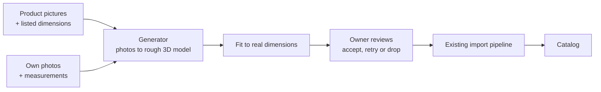

# Asset capture

**Status:** draft; the owner has made the decisions below, and spike 0 is next. **Parent issue:** not filed yet.

## Problem and outcome

The catalog only holds models someone else has already built, so a design can't show the sofa the owner is about to buy, or the chair they already own. The owner wants to turn these into catalog assets at real-world size:

- **Shopping capture:** an online shop's product pictures and listed dimensions.
- **Real-life capture:** photos of a physical piece of furniture, plus its measurements.

Both have the same shape, so they share one path and differ only at the start:

## Out of scope

Buying through the app, a catalog for other people, and matching a product automatically from a design. Linking an asset to the product page it came from is in scope.

## What the current system means for this

- **Most of the back half exists.** `scripts/import-asset.ts` already takes a GLB, simplifies and compresses it, sets the pivot, renders a thumbnail and uploads it.
- **Fitting is uniform and single-axis.** The import accepts only one of `--width`, `--height` and `--depth`. A listing's W × H × D needs a new option, and a choice about how far a generated model may be stretched.
- **`sourceUrl` must be an http(s) URL.** `parseCatalog` hides any entry without one, so a scan of the owner's own chair can't appear today. The [provenance rule](../SYSTEM_DESIGN.md#core-invariants) has to change without weakening it for third-party assets.
- **Everything imported is public.** `seed/` is committed to a public repository, and `GET /api/catalog` and `GET /api/assets/*` are public. A model made from a shop's images or from photos of the owner's home would be world-readable, and the source photos must never go there.
- **Heavy work can't run in Functions.** Generation runs in `scripts/` or on an outside service. A web upload would also need a new owner-only route.
- **Front direction is set by hand** with `--rotate-y`. A generated model may face any way, so review needs to set it.
- **Generated models must fit the [phone budget](../SYSTEM_DESIGN.md#phone-budget).** The import's 60,000-triangle and 1024 px defaults help, but simplifying may damage a generated mesh, so the evaluation measures it.
- **`seed/` holds binaries in git,** a [known limitation](../SYSTEM_DESIGN.md#known-limitations) that many personal assets would make worse. `tests/scripts/seed-catalog.test.ts` also needs a hand-written size range for every model in `seed/`, so a personal asset committed there would fail CI until one is added.

## Decisions

Made by the owner on 2026-11-05.

- **Personal assets live in an R2-only personal catalog,** out of git, under unguessable IDs. This changes the storage model, and slice 2 designs the details.
- **Models made from a shop's images are for private use at first.** They stay out of share links. Copyright in product photos, and in a model derived from them, belongs to someone else, and this needs a real look before changing the decision. Slice 2 designs what a viewer sees instead, such as a generic placeholder of the right size.
- **An asset sourced from a shop links to its product page.** The URL is recorded as its `sourceUrl`, and the editor shows it as a link.
- **The evaluation set covers the five kinds of piece listed under [How we'll judge it](#how-well-judge-it).** The owner chooses the actual pieces and takes the photos.

## Open questions

| Question | Who decides | Options and recommendation |
| --- | --- | --- |
| Which generator? | Owner, because a paid service may be involved | Hosted image-to-3D API, an open model on a local or rented GPU, or a phone scanning app that exports a model (real-life capture only). **Decide after spike 0.** |
| What does a share link's viewer load for a private asset? | Agent, in slice 2 | Designs refer to assets by ID and carry each item's size, so a sized placeholder needs no new data. |
| Fetch product pages automatically? | Agent, unless it needs a paid service | Shops block bots and their terms vary. **Recommend starting from saved images and typed dimensions,** and treating URL fetching as a later, optional slice. |
| How does a model record its provenance? | Agent, within the answer on where assets live | For example a `provenance` field of `third-party` or `own-capture`, requiring `license` and `sourceUrl` only for third-party assets. |

## How we'll judge it

**Evaluation set.** Five pieces the owner can measure, chosen before spike 0 runs, covering these hard cases: a simple table, a soft sofa, a thin-legged chair, an open shelf and a glossy or glass piece. Photos stay outside this repository. Fixtures in the repository use CC0 images or stubs.

| Measure | Bar |
| --- | --- |
| Finished size against measured size | Within 2 cm on each axis |
| Owner's verdict, side by side with the photo from four angles | Would place it in a real design for at least 4 of 5 pieces |
| Finished model size | Within the import's defaults, at most 5 MB |
| Effort per piece | At most 10 minutes of the owner's time |
| Cost per piece | Recorded; the owner sets a limit if it's a paid service |

## Slices

Issues are filed when this brief is accepted.

| # | Slice | Needs | Route |
| --- | --- | --- | --- |
| 0 | Compare two or three generators on the evaluation set, and recommend one with costs | The owner's photos and measurements of the five pieces | Spike |
| 1 | Import takes W × H × D, with a limit on stretching, and reports the distortion | — | Small |
| 2 | Provenance and personal assets: a scan with no URL appears in the catalog, stored in the R2-only personal catalog, and a share link never exposes a private asset | — | Feature slice |
| 3 | `capture` command for own photos: photos and measurements in, review, then import. The generator sits behind an interface, stubbed in tests | 0, 1, 2 | Feature slice |
| 4 | Shopping input: saved product images, listed dimensions and the product URL through the same command, marked private, with the link shown in the editor | 3 | Feature slice |
| 5 | Optional: fetch from a product URL | 4 | Small or spike |
| 6 | Optional: capture from the editor, through a new owner-only route | 3 | Feature slice |

## Findings and decisions

None yet. Candidates worth including in spike 0, not yet evaluated: hosted APIs such as Meshy and Tripo, open models such as TRELLIS and Hunyuan3D, and scanning apps such as Polycam and RealityScan.
